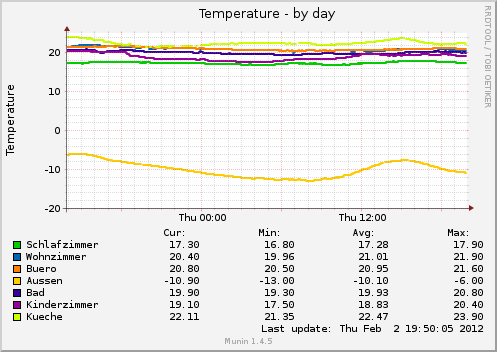
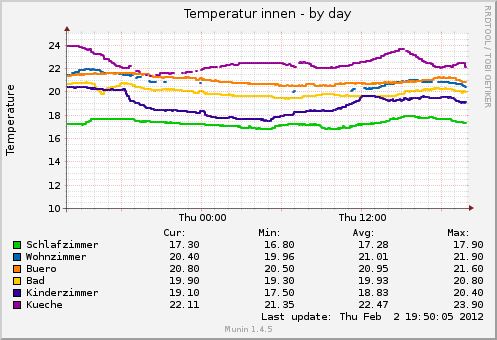

Through the use of the graph\_order directive, when used in [munin.conf](https://guide.munin-monitoring.org/en/latest/reference/munin.conf.html), Munin is able to loan/reuse data already collected by other plugins. This is useful when creating [stacking](https://guide.munin-monitoring.org/en/latest/example/graph/aggregated-stack.html) or [aggregating](https://guide.munin-monitoring.org/en/latest/example/graph/aggregate.html) graphs.

Unfortunately, Munin is not yet able to loan a whole graph from one host/group to another - only single data sources.

## Example: Server load

This example creates a new graph showing the load of two servers.

```
[example.org;Overview]
    address 127.0.0.1 
    use_node_name no
    update no

    loadall.update no
    loadall.graph_title Load of all servers
    loadall.graph_args --base 1000  
    loadall.graph_vlabel Load
    loadall.graph_scale no
    loadall.graph_category system

    loadall.graph_order \
        Server1=sv1.example.org:load.load \
        Server2=sv2.example.org:load.load
```

## Example: Selectively displaying temperatures

The plugin delivers 7 sensor values, but we're interested in some of them only - not all. So we simply create a new graph that contains only some of the data lines. sensor3 is omitted here.

### Before

sensor3 is the outside temperature, which makes it difficult to see the inner temperatures.

[](/assets/wiki/LoaningData/usb_wde1_temperature-day.png)

### After

Afterwards, the inner temperatures are much more readable:

[](/assets/wiki/LoaningData/tempinnen-day.png)

### Code

```
[home.cweiske.de;haus]
    address 127.0.0.1 
    use_node_name no  

    # https://guide.munin-monitoring.org/en/latest/example/graph/aggregated-stack.html
    tempinnen.update no
    tempinnen.graph_title Temperatur innen
    tempinnen.graph_args --base 1000  
    tempinnen.graph_vlabel Temperature
    tempinnen.graph_info Shows the temperature of different thermometers
    tempinnen.graph_scale no
    tempinnen.graph_category innen  

    tempinnen.graph_order \
        Schlafzimmer=haus:usb_wde1_temperature.sensor0 \
        Wohnzimmer=haus:usb_wde1_temperature.sensor1 \  
        Buero=haus:usb_wde1_temperature.sensor2 \
        Bad=haus:usb_wde1_temperature.sensor4 \  
        Kinderzimmer=haus:usb_wde1_temperature.sensor5\
        Kueche=haus:usb_wde1_temperature.sensor6
```
